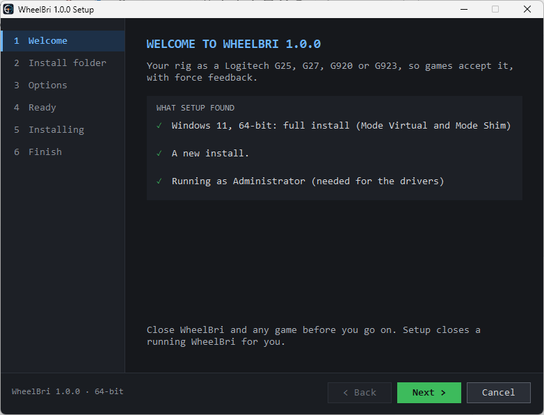
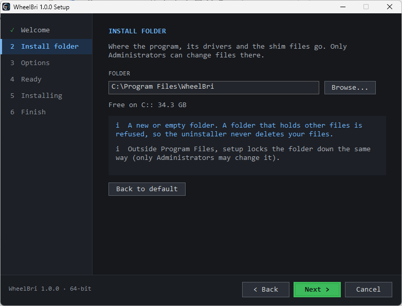
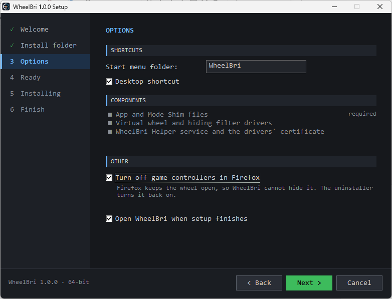
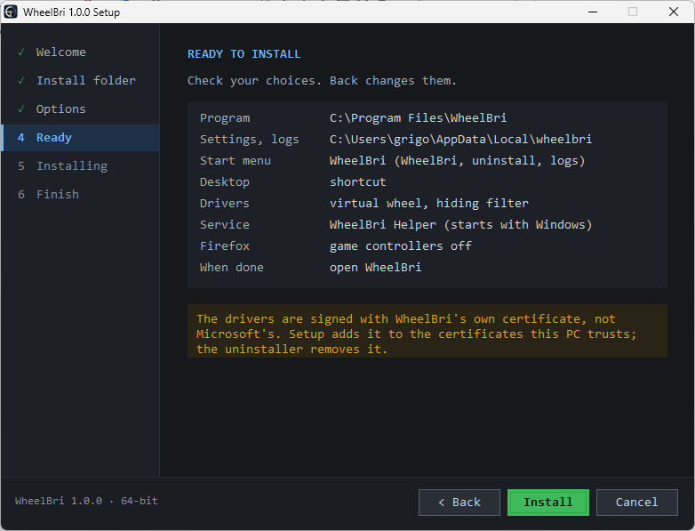
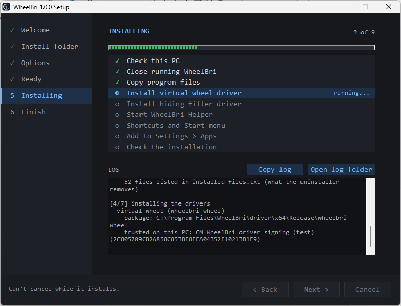
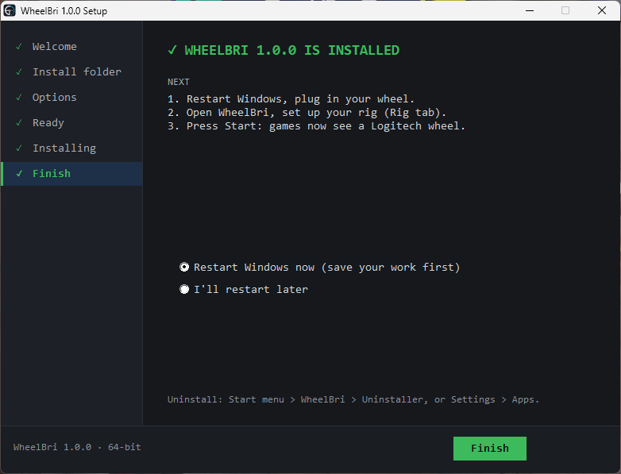
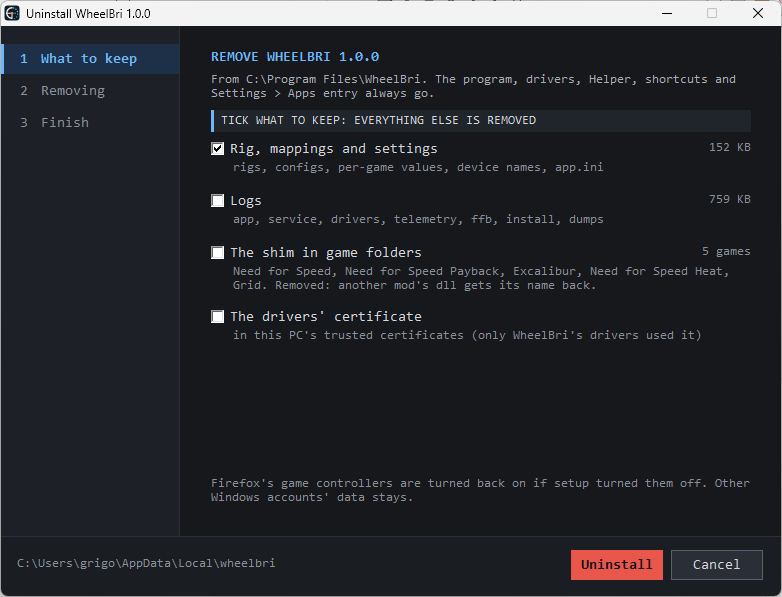
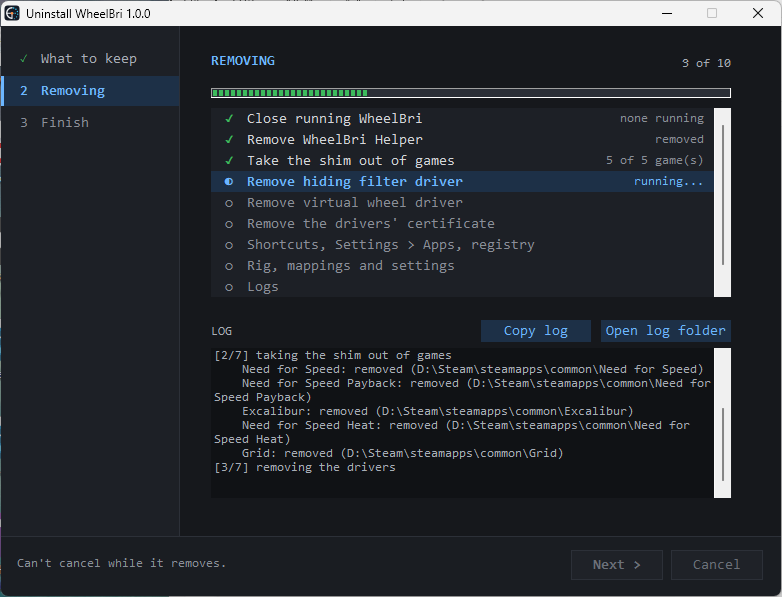
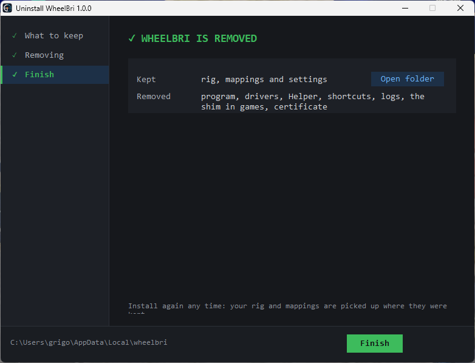

# Install, upgrade, uninstall

Short version in the [README](../README.md#install). Next, once installed: [user-guide.md](user-guide.md).

| System | Download | What you get |
|---|---|---|
| Windows 11, 64-bit | `WheelBri-<version>-setup.exe` (or the `.zip`) | everything: Mode Virtual and Mode Shim |
| Windows 7 SP1, 8, 8.1, 10, 64-bit | the same | Mode Shim only (no drivers, no restart) |
| Linux x86-64 (glibc 2.39 or newer), Steam Deck | `wheelbri-linux-x86_64.tar.gz` | Mode Virtual and Mode Shim |

Releases: <https://github.com/grusnac/WheelBri/releases>

## Windows: the setup wizard

Close WheelBri and any game, run `WheelBri-<version>-setup.exe` and approve the Administrator prompt (the drivers need
it). The wizard:

1. **Welcome**: what setup found. Your Windows and what it gets (full install, or Mode Shim only), an earlier WheelBri
   it will upgrade, and that it runs as Administrator.

   

2. **Install folder**: `C:\Program Files\WheelBri` by default. A new or empty folder, or an earlier WheelBri's; a folder
   holding other files is refused, so the uninstaller never deletes your files. Outside Program Files setup locks the
   folder so only Administrators can change it.

   

3. **Options**:
   - **Start menu folder** (default `WheelBri`): WheelBri, Uninstaller and WheelBri logs go in it.
   - **Desktop shortcut** (on).
   - **Turn off game controllers in Firefox** (off; shown only with Firefox installed). Firefox holds every game
     controller open, so WheelBri cannot hide the wheel while it runs. The uninstaller turns it back on.
   - **Open WheelBri when setup finishes** (on).

   

4. **Ready**: your choices in one list; **Back** changes them, **Install** starts.

   

5. **Installing**: a checklist (check this PC, close a running WheelBri, copy files, install the virtual wheel driver
   and the hiding filter driver, start the WheelBri Helper, shortcuts, Settings > Apps entry, check the installation)
   with the full log below. **Copy log** and **Open log folder** help when something fails.

   

6. **Finish**: **Restart Windows now** (default) or later. Windows 11 needs the restart so the hiding filter takes over
   your rig's devices.

   

What it puts on the PC (all removed by the uninstaller):

- the program in the install folder, the Start menu folder, the desktop shortcut and the Settings > Apps entry;
- two drivers: `wheelbri-wheel` (the virtual wheel, all four Targets) and `wheelbri-hide` (hides your rig while Mode
  Virtual runs);
- the **WheelBri Helper** service (starts with Windows): it does the Administrator work, so the app runs as a normal
  user;
- the drivers' certificate in this PC's trusted stores. The drivers are signed with WheelBri's own certificate, not
  Microsoft's; each release has its own, its private key deleted once the drivers are signed. Secure Boot and test
  mode stay as they are.

Your rig, mappings and settings live in `%LOCALAPPDATA%\wheelbri`, the logs in `%LOCALAPPDATA%\wheelbri\logs`
(the install's own log too: `wheelbri-install-<date>-<NN>.log`).

### Upgrade

Run the new setup. The Welcome page names the version it upgrades; your rig, mappings and settings stay.

### Windows 7 SP1, 8, 8.1 and 10

The same setup installs Mode Shim only: no drivers, no Helper, no restart. It needs nothing installed first: on
Windows 7, 8 and 8.1 without Microsoft's Universal C Runtime (update KB2999226), setup installs it from the package
(`ucrt\`). Windows 8.1 needs its April 2014 update (KB2919355) for that; Windows Update has it, and setup says so.

### Without the wizard

`wheelbri-setup.exe` (in the unpacked `.zip`) installs without a window with `--quiet`. Options:

| Option | What it does |
|---|---|
| `--quiet` | no window, no questions, no restart unless `--restart now` |
| `--install-dir D:\WheelBri` | another install folder |
| `--no-desktop-shortcut` | no desktop shortcut |
| `--start-menu-folder "Games\WheelBri"` | the Start menu folder's name |
| `--stop-browser-gamepads` | turn off Firefox's game controllers |
| `--restart now\|later` | at the end, when the drivers want it (default later) |

`WheelBri-<version>-setup.exe /Q` runs `wheelbri-setup.exe --quiet` too. Exit code 0: installed; 1: failed. Either way
the log says what happened: `%LOCALAPPDATA%\wheelbri\logs\wheelbri-install-<date>-<NN>.log`.

## Windows: the uninstaller

Start menu > WheelBri > **Uninstaller** (or Settings > Apps > WheelBri, or `Uninstaller.exe` in the install folder).

1. **What to keep**: the program, drivers, Helper, shortcuts and Settings > Apps entry always go. One rule for every
   box: **ticked is kept, unticked is removed**.

   | Box | Default | What it is |
   |---|---|---|
   | Rig, mappings and settings | kept | rigs, configs, per-game values, device names, `app.ini`; with its size |
   | Logs | removed | app, service, drivers, telemetry, force feedback, install, dumps |
   | The shim in game folders | removed | lists the games; another mod's DLL WheelBri chained gets its name back |
   | The drivers' certificate | removed | only WheelBri's drivers used it |

   Firefox's game controllers are turned back on if setup turned them off.

   

2. **Removing**: a checklist and log, as when installing.

   

3. **Finish**: what was removed and what was kept (**Open folder** shows it). If Windows still holds a driver, it
   finishes removing it at the next restart. Install again any time: kept settings are picked up where they were.

   

Scripted: `Uninstaller.exe --uninstall --quiet` in the install folder (Settings > Apps' quiet uninstall runs the same).
Its defaults keep more than the Uninstaller's boxes do, so a script never deletes data it was not told to:

| Option | Without it |
|---|---|
| `--remove-settings` | rig, mappings and settings kept |
| `--remove-logs` | logs kept |
| `--keep-shims` | the shim taken out of the game folders |
| `--remove-certificate` | the drivers' certificate kept |
| `--keep-config` | configs edited in the install folder (`config\*.ini`) moved to `%LOCALAPPDATA%\wheelbri\config-backup-<date>` (with it: copied to `config-backup`) |

The quiet uninstall runs from a copy under `%SystemRoot%\Temp` and returns at once; its log is
`%LOCALAPPDATA%\wheelbri\logs\wheelbri-install-<date>-<NN>.log` (with `--remove-logs`: `%TEMP%\wheelbri-uninstall-...`).

## Linux and the Steam Deck

1. Unpack into your home folder (→ `~/wheelbri`):

   ```bash
   tar -xzf wheelbri-linux-x86_64.tar.gz -C ~
   ```

   The bundle needs glibc 2.39 or newer (`ldd --version` shows yours); on an older system, or on the Deck if you
   like, build it instead ([building.md](building.md#steam-deck)).

2. Once per machine, the udev rules (Steam Deck: set a password with `passwd` first), then log out and in:

   ```bash
   ~/wheelbri/install-udev-rules.sh
   ```

   They add you to the group `wheelbri`, which alone may use `/dev/uhid` to create the virtual wheel, let games open
   it and let WheelBri read the rig.

3. Force feedback on the R3 needs the kernel's `hid-universal-pidff` (Linux 6.15 and later):

   ```bash
   modinfo hid-universal-pidff
   ```

4. Set up the rig in the app (`~/wheelbri/bin/wheelbri`), then add the Steam launch option
   ([user-guide.md](user-guide.md#linux-and-the-steam-deck)).

Settings live in `~/.config/wheelbri`, logs in `~/.local/state/wheelbri` (or under `$XDG_CONFIG_HOME` and
`$XDG_STATE_HOME` when those are set).

**Upgrade:** unpack the new bundle over `~/wheelbri`. Your settings stay.

**Uninstall:**

```bash
~/wheelbri/install-udev-rules.sh --remove
```

Then delete `~/wheelbri`, and for a clean start `~/.config/wheelbri` and `~/.local/state/wheelbri`.

## Troubleshooting the install

- **Setup failed**: the red line and the log say why; **Copy log** and send it with your Windows version.
- **`HELPER NOT INSTALLED`** in the app: Win+R, `services.msc`, start "WheelBri Helper", or run the setup again.
- **The rig stays hidden after a crash**: [user-guide.md](user-guide.md#windows).
