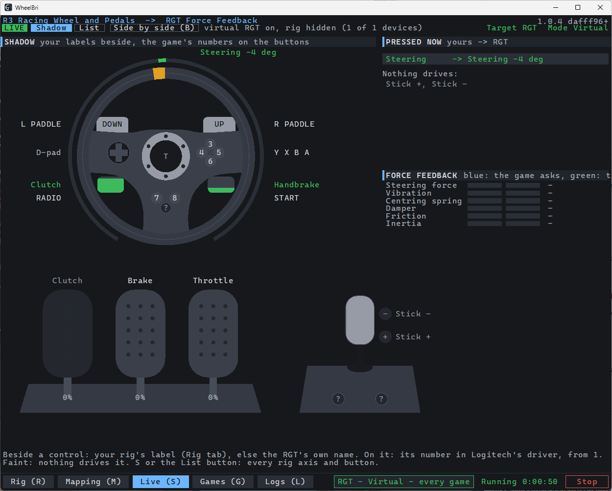

# Target RGT

The **Thrustmaster RGT Force Feedback Pro Clutch Edition** (about 2008): 270 degrees, three pedals, two analog levers
behind the rim, a sequential stick. For games of its era that have a preset for it, such as Race Driver: GRID.
All Targets: [targets.md](targets.md).

| | |
|---|---|
| Ids | 044F:B653, "RGT Force Feedback Pro" (the name Thrustmaster's driver gives it, and the one games look for) |
| Buttons | 10, D-pad as a hat |
| Rotation | 270 degrees, fixed, as the real wheel |
| Modes | Virtual (Windows 11) and Shim; Linux not yet |
| Extras | AXES (2 / 3 / 5) and PEDAL SET (Levers / Clutch), as the wheel's own switches; two levers; centring spring |
| Force feedback | Windows' HID PID driver, no Thrustmaster software needed |
| Tested | not yet in a game with this Target (below) |

## When to pick it

- The game has a preset for the "RGT Force Feedback Pro" and none for a Logitech wheel WheelBri offers.
- Race Driver: GRID has one (preset 5, from the game's files), but its [G25](target-g25.md) preset is the tested one.

## Set up

1. Mapping tab: **Target RGT**, **Mode** Virtual (or Shim for a DirectInput game).
2. **AXES** and **PEDAL SET** (below): what the real wheel's mode switch and pedal switch did, here with no
   Thrustmaster software. The defaults are 5 axes and Clutch. For GRID see [Known](#known).
3. With **Levers**: map **Left lever** and **Right lever** to controls on your rig (a handbrake, a second pedal).
   The Rig never maps them. Start refuses until both are mapped.
4. The Rig maps A, B, X, Y to Button 6, 5, 4, 3 (GRID's menu Select, Back, Boost, Look back) and the paddles to Down
   and Up. Map the other buttons and the stick yourself.
5. **Centring spring** (0-100%, off by default): a spring to the centre on top of the game's forces, as
   Thrustmaster's Control Panel had. Applies at the next Start.

## Axes

Wheel X, then four pedal axes. What they carry follows AXES and PEDAL SET, as the table in Thrustmaster's manual:

| AXES | PEDAL SET | Y | Rz | Slider 0 | Slider 1 |
|---|---|---|---|---|---|
| 5 | Clutch (default) | brake | throttle | clutch | at rest |
| 5 | Levers | brake | throttle | left lever | right lever |
| 3 | Levers | brake or left lever | throttle or right lever | at rest | at rest |
| 2 | Levers | throttle and brake on one axis (with both levers) | at rest | at rest | at rest |

- **Clutch always means 5 axes**, as on the real wheel: 2 and 3 are greyed while Clutch is picked.
- The rows the pedal set does not report are greyed on the Mapping tab: the clutch with Levers, the levers with
  Clutch.
- Combined pedals do not apply to the RGT: AXES decides what is combined.
- The pedals and levers rest at the top of the range, as a real RGT's.
- The same axes in both Modes.
- Not checked on a real RGT: which way 2 axes moves Y (the G25's combined pedals' way is used), and that 3 axes reports
  whichever of a pedal and its lever is pressed further.

## Buttons

Numbers as the game and the app count them (from 1). `target_N` in the INI is the number minus 1. There is one order,
the one Thrustmaster's driver gives.

| # | Button | From the Rig |
|---|---|---|
| 1 | Down paddle | Left paddle |
| 2 | Up paddle | Right paddle |
| 3 | Button 3 | Y |
| 4 | Button 4 | X |
| 5 | Button 5 | B |
| 6 | Button 6 | A |
| 7, 8 | Button 7, Button 8 | |
| 9 | Stick + (up a gear) | |
| 10 | Stick - (down a gear) | |
| hat | D-pad | D-pad |

Which physical button on the rim is Button 3 to 8 is not known yet: Thrustmaster's documents do not say.

## Force feedback

- **Windows**: Windows' HID PID driver plays the game's effects on the virtual RGT; WheelBri plays them on your rig
  through its safety limits. No Thrustmaster software is needed.
- **With Thrustmaster's driver installed**: not supported yet. Its force feedback driver would take the virtual RGT
  over; WheelBri does not check for it yet.
- Not yet checked: which way GRID pushes on the RGT. In a test build it pushed away from the centre.

## Shadow view

The RGT from the front: DOWN and UP on the paddles, the D-pad, the rim's buttons by number, the sequential stick
with + and -, the three pedals. The rim's buttons are placed as a guess: four on the right (Button 3 to 6), two on
the bottom spoke (7, 8); the three whose number is not known show "?".

The levers' tabs behind the side spokes fill from the bottom as you move them, with what drives each beside it. With
PEDAL SET Clutch they are faint and say "off: Clutch": the game does not get them.

## Known

- Not yet tested in a game with this Target. A test build in Race Driver: GRID (Mode Shim): GRID took it as the RGT,
  the pedals and menu buttons worked; its force feedback pushed outward.
- GRID's RGT preset (from the game's files, not checked in the game) reads the throttle on Rz or Slider 1 and the
  brake on Y or Slider 0, the 5 axes Levers layout, and has no clutch action. So with **Levers** the levers are a
  second throttle and brake; with **Clutch** the clutch pedal, on Slider 0, would brake.
- Linux (`wheelbri-uhid`, Proton): not yet.
