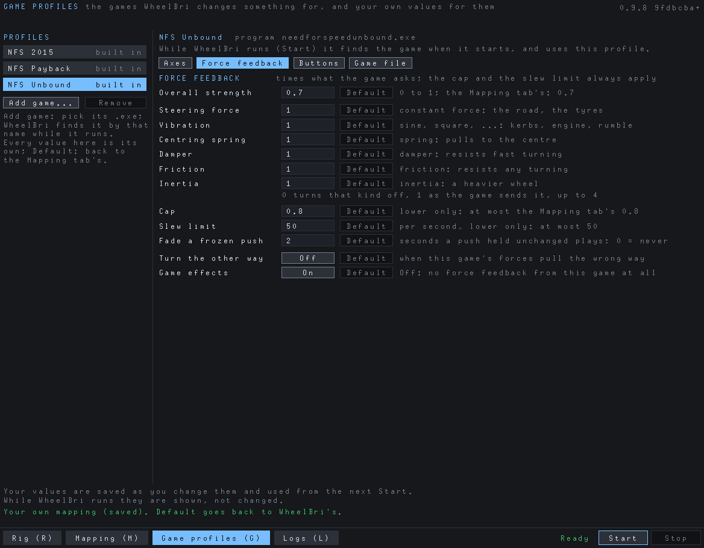

# WheelBri user guide

WheelBri makes your rig (a wheel and its pedals, shifter or button box) look like a Logitech wheel, so games that only
accept Logitech wheels accept yours, with force feedback. It is built and tested with a Moza R3; other wheels should
work but are untried.

- [Install](#install)
- [Set up your rig](#set-up-your-rig)
- [Map it to the Target](#map-it-to-the-target)
- [Play](#play)
- [Game profiles](#game-profiles)
- [Force feedback](#force-feedback)
- [Logs](#logs)
- [Uninstall](#uninstall)
- [Troubleshooting](#troubleshooting)

Two choices decide how it works:

- **Target**: the Logitech wheel games see. **G920** is the default and the only one tried in games so far. G25 and G27
  are for older games; G923 is the G920's successor.
- **Mode**: **Virtual** (Windows 11) creates the Target as a virtual wheel every game sees and hides your rig while
  WheelBri runs. **Shim** puts a `dinput8.dll` next to one game, which shows the Target to that game only.

Which games were played and what each needs: [games.md](games.md). Linux and the Steam Deck:
[README](../README.md#linux-and-the-steam-deck).

## Install

1. Run `WheelBri-<version>-setup.exe` and approve the Administrator prompt.
2. Restart Windows when it asks (Windows 11): the filter that hides your rig often starts only after a restart.

On Windows 11 the setup installs the program, the two drivers with their certificate, and the **WheelBri Helper**, a
service that does the Administrator work so the app itself runs as a normal user. On Windows 7 to 10 it installs Mode
Shim only (untested there). Windows 7 first needs the prerequisites in the package's `win7` folder: run
`download-prerequisites.cmd`, then `install-prerequisites.cmd` as administrator, and restart.

To upgrade, run the new setup: your rig, mappings and settings stay.

## Set up your rig

Open **WheelBri**. The tabs are along the bottom (Rig, Mapping, Game profiles, Logs; press R, M, G, L), with the status,
**Start** and **Stop** at the right.


1. With **Detect: on**, touch a control: turn the wheel, press a pedal **all the way**, press a button. Its popup opens.
2. Give it a **Name** or pick what it **is** (Steering, Throttle, Brake, Clutch, a button...). For a pedal that rests at
   the top, **Inverted** is set for you.
3. Press **OK**. Repeat for every control you use.
4. Name each device, then press **Save**.

The device with the Steering axis is the wheel; it plays the force feedback. WheelBri has no dead zones: set those, and
the wheel's rotation, in the wheel's own software (Pit House for Moza).

## Map it to the Target


1. Pick the **Target** and the **Mode** with `<` and `>` at the top.
2. Check each of the Target's axes, D-pad and buttons comes from the right control: click a source to change it. A
   button can have an extra source ("or"), for example a handbrake lever.
3. Set **Steering rotation** to the game's full lock, and set your wheel's own software to **the same number**.
4. Press **Save**. **Default** goes back to WheelBri's mapping.

## Play

Press **Start** before you start the game, and **Stop** when you are done. The status shows `Running`.

**Mode Virtual** (Windows 11)

1. Close the wheel maker's software if it holds the wheel.
2. Press **Start**. The first time, the rig is hidden from games ("first time only", up to a minute; do not unplug
   anything).
3. Start the game and pick the Logitech wheel in its controller settings.

**Mode Shim**


1. Press **Games**, then **Add game**, and choose the folder with the game's `.exe`. WheelBri puts the right shim there
   (32 or 64-bit, next to the Ultimate ASI Loader if you have it) and never overwrites another mod's `dinput8.dll`.
2. Click the game to pick it, close the panel and press **Start**.
3. Start the game and pick the Logitech wheel.
4. At **Stop**, choose whether to delete the shim from the game folder.

Do not use both Modes for one game. With a wheel that is not a Moza, set `source_vid` in the game folder's
`wheelbri-shim.ini` to your wheel's vendor id (the first 4 characters of its `vid:pid` in the Rig tab).

## Game profiles

Everything that can differ from game to game is set here, for one game at a time. A few games come with a built-in
profile that WheelBri applies by itself while they run: NFS 2015 (its pedals), NFS Payback (180 degrees) and NFS
Unbound (stronger force feedback and its hidden wheel settings). Built-in profiles work **with Target G920 only**; your
own values work with every Target.



1. Pick the game on the left, or press **Add game...** and choose its `.exe` (WheelBri finds it by that name while it
   runs). **Remove** takes a game you added off the list.
2. Set what you want in its sub-tabs; **Default** next to a value goes back to the profile's or the Mapping tab's:
   - **Axes**: the steering rotation, the axis the game reads each pedal from, and each pedal's invert and curve.
     In Mode Virtual the pedals can only be swapped among Y, Rz and Slider.
   - **Force feedback**: overall strength, a gain per kind of effect (steering force, vibration, spring, damper,
     friction, inertia: 0 turns it off, up to 4), a lower cap or slew limit, the frozen-push fade, turning the forces
     the other way, or no force feedback at all.
   - **Buttons**: another control for any button, for this game only.
   - **Game file** (NFS Unbound): the game's own hidden wheel settings, written with **Save to file** (game
     closed).

Values are saved as you change them. **While the game runs you can change them too**: they apply at once (the Force
feedback sub-tab then shows, per kind of effect, what the game asks in blue and what reaches the wheel in green).
Pedal axes in Mode Shim and new games take effect at the next Start.

## Force feedback

Every force goes through safety limits first. The defaults are cautious: 70% overall strength, never more than 80% of
what the wheel can do, no sudden jumps, and a push the game leaves unchanged for 2 seconds (a loading screen) fades out.

For one game, use the Game profiles tab. For every game, edit `[ffb]` in your mapping file,
`%LOCALAPPDATA%\wheelbri\configs\my-<target>.ini` (it exists once you saved a mapping), and press Start again:

| Setting | Default | |
|---|---|---|
| `master_gain` | 0.7 | overall strength |
| `max_magnitude` | 0.8 | the hard cap; raise only with care |
| `invert` | false | `true` if forces pull the wrong way |
| `game_effects` | true | `false` turns game force feedback off |

To test the wheel, press Stop in the app and run in a Command Prompt:

```
"C:\Program Files\WheelBri\wheelbri-service.exe" --ffb-test --config "%LOCALAPPDATA%\wheelbri\configs\my-g920.ini"
```

## Logs

The **Logs** tab shows what every part of WheelBri does; press **O** to open the folder
(`%LOCALAPPDATA%\wheelbri\logs`). Logs older than 2 days are deleted.

To report a problem: set **Level** to debug, repeat what went wrong, press Stop, and send today's files from the folder
with the Target, the Mode, the game and what you saw. Set Level back to warn afterwards.

## Uninstall

1. In Mode Shim, remove the shim from your games first (Games, **Remove shim**).
2. Start menu > WheelBri > Uninstall WheelBri (or Settings > Apps), and answer its questions.

Your rig, mappings and logs in `%LOCALAPPDATA%\wheelbri` are kept; delete that folder for a clean start.

## Troubleshooting

Look at the Logs tab first: a failed Start says why there, in red.

**Start is greyed out.** The status says why:

| Status | What to do |
|---|---|
| `NO RIG` / `NO WHEEL IN THE RIG` | Name your controls in the Rig tab and Save. |
| `NO MAPPING` | Map the Target's inputs in the Mapping tab and Save. |
| `NOT CONNECTED: <names>` | Switch on or plug in those devices. |
| `HELPER NOT INSTALLED` | See below. |

**Other statuses while playing:**

| Status | What to do |
|---|---|
| `WHEEL LOST` | A device was unplugged or switched off: plug it back in. |
| `GAME NOT USING WHEEL` | The game drives from a gamepad or keyboard: see below. |
| `GAME FFB OFF: ALT-TAB` | The game loaded its force feedback but never started it: Alt+Tab out and back. |
| `NFS 2015: RESET ITS WHEEL CONTROLS` | In the game, reset the wheel controls to default. |

**The game sees no wheel.**
- Press Start **before** starting the game, and check the status says `Running`.
- Mode Virtual: Win+R, `joy.cpl` must list the Target and not your rig.
- Mode Shim: the game must say "shim in place" in the Games panel, and a `wheelbri-shim-...` log must appear when the
  game starts. With a non-Moza wheel, check `source_vid` (see [Play](#play)).
- NFS Payback needs Logitech G HUB: see [games.md](games.md#nfs-payback).

**The game sees two wheels.** In Mode Virtual the app should say "rig hidden"; "NOT HIDDEN" names the device it could
not hide. Close the wheel maker's software and the game, replug the device (or restart Windows) and Start again. In Mode
Shim nothing is hidden: pick the Logitech wheel.

**The game drives from an Xbox pad or the keyboard.** Close the game with WheelBri running, unplug the gamepad, start
the game again and pick the Logitech wheel.

**No force feedback, but the wheel works.** Alt+Tab if the status says so; check force feedback is on in the game and in
the wheel's software; check `game_effects = true`; try `--ffb-test` ([Force feedback](#force-feedback)).

**Force feedback too strong, too weak or the wrong way.** Change `master_gain` or `invert`
([Force feedback](#force-feedback)), or the game's gain in the Game profiles tab. Check the wheel's own strength too.

**The pedals are wrong.** In the Rig tab press each pedal all the way: its bar must go from released to pressed, else
toggle **Inverted**. In the Mapping tab check Throttle, Brake and Clutch come from the right controls. A pedal that does
not reach 100%: set its range in the pedals' own software.

**`HELPER NOT INSTALLED`.** Win+R, `services.msc`, start "WheelBri Helper"; or run the setup again. Mode Shim does not
need it.

**The rig stays hidden after a crash.** Press Start and Stop once. If it is still hidden with WheelBri closed, run in an
Administrator Command Prompt:

```
"C:\Program Files\WheelBri\wheelbri-service.exe" --unhide
```

**The app does not start on Windows 7.** The Universal C Runtime (KB2999226) is missing: run
`install-prerequisites.cmd` from the `win7` folder and restart.
