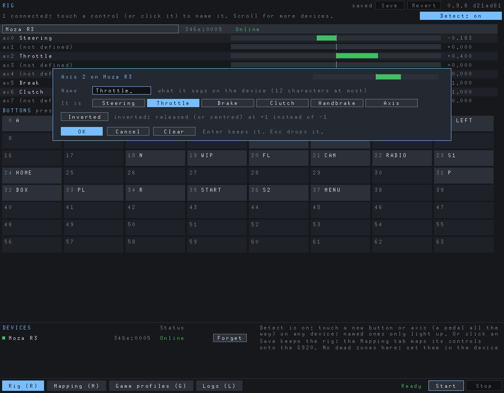
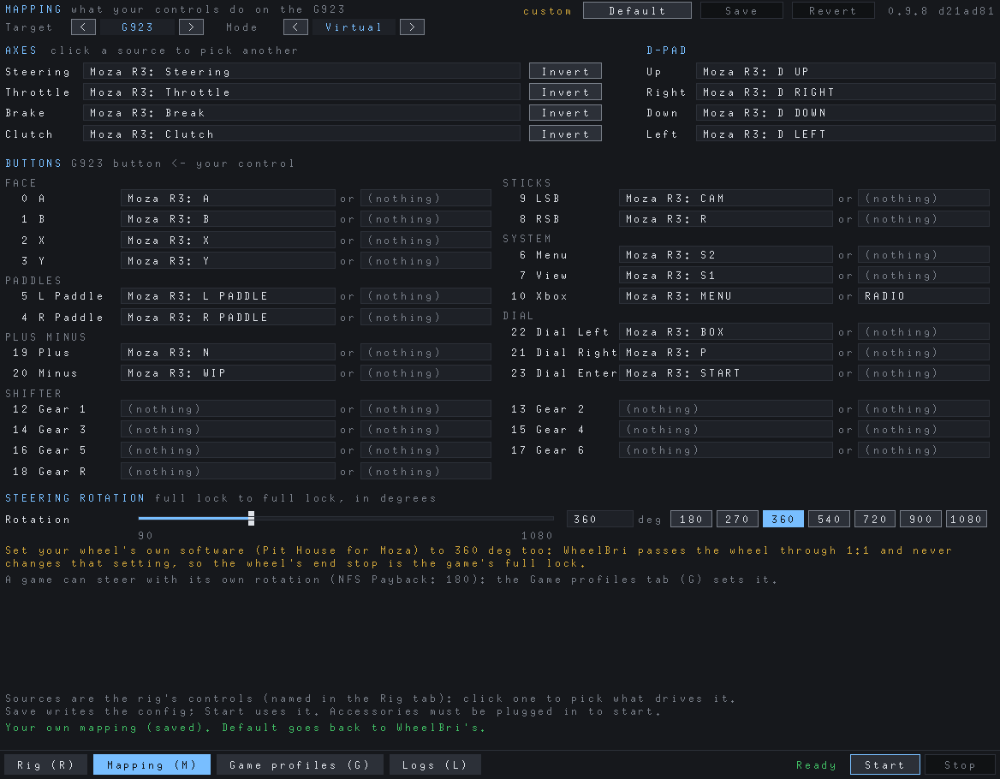
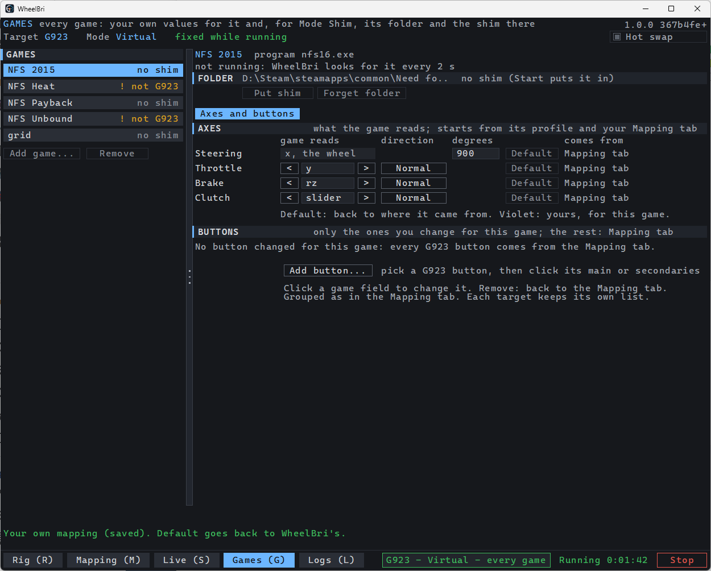

# WheelBri user guide

WheelBri makes your rig (a wheel and its pedals, shifter or button box) look like a Logitech wheel, so games that only
accept Logitech wheels accept yours, with force feedback. It is built and tested with a Moza R3; other wheels should
work but are untried.

- [Install](#install)
- [Set up your rig](#set-up-your-rig)
- [Map it to the Target](#map-it-to-the-target)
- [Play](#play)
- [Games](#games)
- [Force feedback](#force-feedback)
- [Logs](#logs)
- [Uninstall](#uninstall)
- [Troubleshooting](#troubleshooting)

Two choices decide how it works:

- **Target**: the Logitech wheel games see. **G920** is the default and the only one tried in games so far. G25 and G27
  are for older games; G923 is the G920's successor.
- **Mode**: **Virtual** (Windows 11) creates the Target as a virtual wheel every game sees and hides your rig while
  WheelBri runs. **Shim** puts a `dinput8.dll` next to one game, which shows the Target to that game only.

Which games were played and what each needs: [games.md](games.md). Linux and the Steam Deck:
[README](../README.md#linux-and-the-steam-deck).

## Install

1. Run `WheelBri-<version>-setup.exe` and approve the Administrator prompt.
2. Restart Windows when it asks (Windows 11): the filter that hides your rig often starts only after a restart.

On Windows 11 the setup installs the program, the two drivers with their certificate, and the **WheelBri Helper**, a
service that does the Administrator work so the app itself runs as a normal user. On Windows 7 to 10 it installs Mode
Shim only (untested there). Windows 7 first needs the prerequisites in the package's `win7` folder: run
`download-prerequisites.cmd`, then `install-prerequisites.cmd` as administrator, and restart.

To upgrade, run the new setup: your rig, mappings and settings stay.

## Set up your rig

Open **WheelBri**. The tabs are along the bottom (Rig, Mapping, Games, Logs; press R, M, G, L), with the status
and **Start** at the right (it turns into **Stop** while WheelBri runs). Point at a button (Detect, Undo, Show
all...) to see what it does.



1. With **Detect** ticked, touch a control: turn the wheel, press a pedal **all the way**, press a button. Its
   popup opens.
2. Give it a **Name** or pick what it **is** (Steering, Throttle, Brake, Clutch, a button...). Which way an axis
   reads is set on the Mapping tab (**Invert**); the popup says when a pedal rests at the top.
   What it **is** maps it by itself: **Steering**, **Throttle**, **Brake**, **Clutch**, the D-pad (**D Up**,
   **D Right**, **D Down**, **D Left**), **A**, **B**, **X**, **Y** and the paddles go to the Target's own, on every
   Target (the G25 and G27 have no A, B, X, Y: those go on the shifter's black buttons, A bottom, B right, X left, Y
   top). Each of them is one control's only: picked for another control, it moves there (an amber line under it
   says which control has it now). Every other button you map yourself in the Mapping tab.
3. Press **OK**. Repeat for every control you use.
4. Name each device. Every change is saved at once; **Undo** goes back one change at a time.

Once a device has a named control, only its named axes and buttons are listed; the others fold into one line each
("4 axes not named (1, 3, 4, 7)"). **Show all** lists every control again, **Named only** folds them back.

The device with the Steering axis is the wheel; it plays the force feedback. WheelBri has no dead zones: set those, and
the wheel's rotation, in the wheel's own software (Pit House for Moza).

## Map it to the Target



1. Pick the **Target** and the **Mode** with their buttons at the top; point at one to see what it is for (from Start
   until Stop they cannot change).
2. Check each of the Target's axes, D-pad and buttons comes from the right control: click a source to change it (in
   its popup, press or move the control on your rig, or type to find it; one used elsewhere is greyed). **RIG**
   beside a source: it comes from what the control is in the Rig tab; pick another and it is yours. Which way a pedal
   reads is always yours: tick **Invert** if it is pressed at rest. A button can have an extra source ("or": **+ or** at
   the end of its row), for example a handbrake lever: it presses the button past the point of its travel you set
   with the slider or type in, from 0% (as soon as it moves) to 100% (only at its end). In its popup, press the
   control on your rig to add it (while stopped), or type to find it by number or name; a long list scrolls with the
   mouse wheel. A group with nothing mapped (the **Shifter** without a shifter) is one line: **Show** opens it.
3. Set **Steering rotation** to the game's full lock, and set your wheel's own software to **the same number**.
   With the **G25** or **G27** as Target, **Centring spring** below it is that wheel's own (Logitech's software had
   it: "Enable Centering Spring in Force Feedback Games", 0 to 100%): a spring to the centre on top of the game's
   forces, in every game. Off by default; Race Driver: GRID needs it, as it sends no centring of its own.
   **Button order** under it says which numbering the game gets the G25's or G27's buttons in: **Logitech driver**
   (the default, as Logitech's Windows software numbered them: games of that time, such as Race Driver: GRID) or
   **Native** (the wheel's own, without Logitech's driver: newer games' presets, such as Assetto Corsa
   Competizione's). The Mapping tab names the buttons the same way either way.
   The Target's buttons show by **the numbers the game uses**, the way the real Logitech wheel numbers them: from 1
   with **Logitech driver** (as joy.cpl and games show them: when DiRT Rally 2.0 asks for "Button 7", that is the
   G25's 7 R Wheel), from 0 with **Native** (the wheel's own order). Press a button on your rim and **Last pressed**
   says which one the game gets. The rig's buttons and the INI's `target_N` still count from 0.
4. Every change is saved at once and Start uses what you see. **Undo** goes back one change at a time,
   **Default** to WheelBri's mapping.

## Play

Press **Start** before you start the game, and **Stop** (the same button) when you are done. The status shows
`Running`. Start is green when it can run.

Next to Start, on every tab, the bar shows what Start runs: Target, Mode and (Mode Shim) the game, green while it
runs, amber when the game does not support the Target. Click it to go to the Mapping tab. When Start is greyed out,
a red notice above the tabs says what to do; click Start or the notice's **What's missing** for a list of what is
done and what is still to do. While running, the same notice says what is wrong (a device unplugged, the game not
using the wheel). The Mapping tab is marked EDIT while stopped and LIVE
while running; after a hot swap or a shim put in, a short green message says what happened.

**Shadow view** (every Target). While running, the Mapping tab draws the Target (wheel, pedals and shifter) and lights
every control the game sees pressed: the buttons, the D-pad, the gear the knob is in, the pedals filling up as you
press them and an arc for how far the wheel is turned. On each button is its number as the game numbers it (from 1
with the Logitech driver order, from 0 with the native one: the Mapping tab's Button order); beside it the label you
gave the control that drives it in the Rig tab, or the wheel's own name (Red 2, the gears) if that control has none. On
the G920 and G923 each button shows what is printed on the real one instead of a number (A B X Y, LSB / RSB, the View,
Menu and Xbox symbols, the G923's + and -, the shifter's gears); the paddles show nothing. The G923's dial lights its
left or right teeth as it turns. A faint control has nothing driving it. On the right, what is pressed now, yours first. **List** (or S) switches to
every rig axis and button, **Shadow** back.


**Mode Virtual** (Windows 11)

1. Close the wheel maker's software if it holds the wheel.
2. Press **Start**. The first time, the rig is hidden from games ("first time only", up to a minute; do not unplug
   anything).
3. Start the game and pick the Logitech wheel in its controller settings.

**Mode Shim**

1. On the **Games** tab (G), add your games: pick a game and press **Choose folder...** (or **Add game...** for a
   game WheelBri does not know), and choose the folder with the game's `.exe`. Start needs at least one game.
2. Press **Start**. Every listed game's folder gets the right shim (32 or 64-bit, next to the Ultimate ASI Loader if
   you have it), set to the Target; another mod's `dinput8.dll` is never overwritten (that game is left out). There
   is no game to pick: start any of them, and the bar next to Start shows the one WheelBri sees running.
3. Start the game and pick the Logitech wheel.
4. If a game runs for 2 minutes without a word from the shim, WheelBri says so (a Windows notification and a
   popup): the emulation is stalled, or the shim is not in that game's folder. Check its folder on the Games tab,
   then restart the game.
5. At **Stop** (after a session where the shim worked), choose whether to delete the shims from the games' folders.
   With **Don't ask again** your answer is kept; **Ask again** on the Games tab brings the question back.

The Mapping tab's **Game** row lists the games; its **Games** button opens the Games tab.

**Hot swap** (the switch at the top right of the Games tab, on by default): when you change the Target in Mode Shim,
every game whose folder has the shim gets the new Target (its FOLDER section says which wheel it presents, the list
says "shim g923"); games without the shim are left alone. Off: they get it at Start. Restart a game that
was running to get the new Target.

Do not use both Modes for one game. With a wheel that is not a Moza, set `source_vid` in the game folder's
`wheelbri-shim.ini` to your wheel's vendor id (the first 4 characters of its `vid:pid` in the Rig tab).

## Games

Everything that can differ from game to game is set here, for one game at a time. A few games come with a built-in
profile that WheelBri applies by itself while they run: NFS 2015 (its pedals), NFS Payback (180 degrees) and NFS
Unbound (stronger force feedback and its hidden wheel settings). Built-in profiles work **with Target G920 only**; your
own values work with every Target.



The top of this tab shows the Target and the Mode the values are for (each Target keeps its own values); change them
on the Mapping tab, while WheelBri is stopped. While it runs the Mapping tab shows them in its header.

1. Pick the game on the left. Every game is listed once: the built-in ones, the ones you added, and game folders with
   the shim that WheelBri does not know (by folder name, with **Add as your game...**). The tag says what is in its
   folder (`shim g920`, `no shim`, `other mod`), or `! not G923` when the game does not support the Target;
   `running` the one WheelBri sees now. **Add game...** picks a game's `.exe` (WheelBri finds it by that name
   while it runs; its folder joins the list, no shim put in). **Remove** takes a game you added off the list,
   with its own values and the folder Add game listed (its files stay; when WheelBri's shim is in it, the folder
   stays listed until you press **Remove shim** and **Forget folder**).
   **FOLDER**: see [Play](#play), Mode Shim. **Forget folder** takes the folder off the list and leaves its files.
   A name too long for the list ends in `..` (point at it for the whole name). Drag the bar between the list and the
   game to make the list wider or narrower, or double-click the bar to fit the longest name; the width is kept for
   the next start.
2. Set what you want in its sub-tabs; **Default** next to a value goes back to the profile's or the Mapping tab's
   (yours are in violet, as everywhere in WheelBri):
   - **Axes**: the steering rotation, and for each pedal the axis the game reads it from and Normal / Inverted.
     Each row starts from the game's profile or your Mapping tab. In Mode Virtual the pedals can only be swapped
     among Y, Rz and Slider (Y, Rz and Z on the G25). How they feel (dead zones, curves) is set in your rig's own
     software.
   - **Force feedback**: overall strength, a gain per kind of effect (steering force, vibration, spring, damper,
     friction, inertia: 0 turns it off, up to 4), a lower cap or slew limit, the frozen-push fade, turning the forces
     the other way, or no force feedback at all.
   - **Buttons**: only the buttons you change for this game, grouped as in the Mapping tab. **Add button...** shows
     the Target's buttons: pick one, then the control for it (or nothing). Click a row's control to change it;
     **Remove** gives the button back to the Mapping tab. Each Target keeps its own list.
   - **Game file** (NFS Unbound): the game's own hidden wheel settings, written with **Save to file** (game
     closed). WheelBri knows the game's file for sure once it has seen the game write it: play the game once while
     WheelBri runs (it writes its file when it ends). A file found with **Locate...** that the game has not been seen
     writing says so in amber, and **Save to file** then asks first (press it again to write anyway): another game
     can keep a file of the same name with the same settings (NFS Heat's for NFS Unbound).

Values are saved as you change them. **While the game runs you can change them too**: they apply at once (the Force
feedback sub-tab then shows, per kind of effect, what the game asks in blue and what reaches the wheel in green).
Pedal axes in Mode Shim and new games take effect at the next Start.

## Force feedback

**How strong the force feedback is, you set in your wheel's own app**, the same for every game: Moza Pit House
(maximum output torque, game force feedback intensity), Fanatec's tuning menu, Simucube True Drive, Thrustmaster's
control panel, Logitech G HUB. WheelBri passes all of what the game asks.

Every force still goes through safety limits: no sudden jumps, a push the game leaves unchanged for 2 seconds (a loading
screen) fades out, all forces stop when the game goes quiet, and a value that is not a force (Race Driver: GRID with
VSync off, which Windows turns into a full push) plays nothing.

Mappings you saved earlier with WheelBri's older, cautious limits (70% strength, at most 80%) are moved to the new
ones (1 and 1) when the app opens, all of them at once; the status line says so. **Turn the strength down in the
wheel's app before the first race after that**: forces get about 1.4 times stronger. Other values you set yourself
stay as they are.

For one game, use the Games tab. For every game, edit `[ffb]` in your mapping file,
`%LOCALAPPDATA%\wheelbri\configs\my-<target>.ini` (it exists once you saved a mapping), and press Start again:

| Setting | Default | |
|---|---|---|
| `master_gain` | 1.0 | overall strength; set it in the wheel's app instead |
| `max_magnitude` | 1.0 | the hard cap (1 = none of WheelBri's own) |
| `invert` | false | `true` if forces pull the wrong way |
| `game_effects` | true | `false` turns game force feedback off |
| `centring_spring` | 0 | G25 and G27 only: their centring spring, 0 (off) to 100% (the Mapping tab sets it) |

To test the wheel, press Stop in the app and run in a Command Prompt:

```
"C:\Program Files\WheelBri\wheelbri-service.exe" --ffb-test --config "%LOCALAPPDATA%\wheelbri\configs\my-g920.ini"
```

## Logs

The **Logs** tab shows what every part of WheelBri does; press **O** to open the folder
(`%LOCALAPPDATA%\wheelbri\logs`). Logs older than 2 days are deleted.

To report a problem: set **Level** to debug, repeat what went wrong, press Stop, and send today's files from the folder
with the Target, the Mode, the game and what you saw. Set Level back to warn afterwards.

## Uninstall

1. In Mode Shim, remove the shim from your games first (Games tab, **Remove shim**).
2. Start menu > WheelBri > Uninstall WheelBri (or Settings > Apps), and answer its questions.

Your rig, mappings and logs in `%LOCALAPPDATA%\wheelbri` are kept; delete that folder for a clean start.

## Troubleshooting

Look at the Logs tab first: a failed Start says why there, in red.

**Start is greyed out.** The notice above the tabs and the status say why:

| Status | What to do |
|---|---|
| `NO RIG` / `NO WHEEL IN THE RIG` | Name your controls in the Rig tab. |
| `NO MAPPING` | Map the Target's inputs in the Mapping tab. |
| `NOT CONNECTED: <names>` | Switch on or plug in those devices. |
| `HELPER NOT INSTALLED` | See below. |

**Other statuses while playing:**

| Status | What to do |
|---|---|
| `WHEEL LOST` | A device was unplugged or switched off: plug it back in. |
| `GAME NOT USING WHEEL` | The game drives from a gamepad or keyboard: see below. |
| `GAME FFB OFF: ALT-TAB` | The game loaded its force feedback but never started it: Alt+Tab out and back. |
| `NFS 2015: RESET ITS WHEEL CONTROLS` | In the game, reset the wheel controls to default. |

**The game sees no wheel.**
- Press Start **before** starting the game, and check the status says `Running`.
- Mode Virtual: Win+R, `joy.cpl` must list the Target and not your rig.
- Mode Shim: the game's FOLDER section on the Games tab must say "shim in place", and a `wheelbri-shim-...` log
  must appear when the game starts. With a non-Moza wheel, check `source_vid` (see [Play](#play)).
- NFS Payback needs Logitech G HUB: see [games.md](games.md#nfs-payback).

**The game sees two wheels.** In Mode Virtual the app should say "rig hidden"; "NOT HIDDEN" names the device it could
not hide. Close the wheel maker's software and the game, replug the device (or restart Windows) and Start again. In Mode
Shim nothing is hidden: pick the Logitech wheel.

**The game drives from an Xbox pad or the keyboard.** Close the game with WheelBri running, unplug the gamepad, start
the game again and pick the Logitech wheel.

**No force feedback, but the wheel works.** Alt+Tab if the status says so; check force feedback is on in the game and in
the wheel's software; check `game_effects = true`; try `--ffb-test` ([Force feedback](#force-feedback)).

**Force feedback too strong, too weak or the wrong way.** Set the strength in the wheel's own app (Pit House for a
Moza); for one game, its gain in the Games tab; `invert` if it pulls the wrong way ([Force feedback](#force-feedback)).

**The pedals are wrong.** In the Mapping tab check Throttle, Brake and Clutch come from the right controls, and press
each pedal: one that reads pressed at rest needs **Invert** on its row. A pedal that does
not reach 100%: set its range in the pedals' own software.

**`HELPER NOT INSTALLED`.** Win+R, `services.msc`, start "WheelBri Helper"; or run the setup again. Mode Shim does not
need it.

**The rig stays hidden after a crash.** Press Start and Stop once. If it is still hidden with WheelBri closed, run in an
Administrator Command Prompt:

```
"C:\Program Files\WheelBri\wheelbri-service.exe" --unhide
```

**The app does not start on Windows 7.** The Universal C Runtime (KB2999226) is missing: run
`install-prerequisites.cmd` from the `win7` folder and restart.
