# WheelBri user guide

How to set up your rig, map it to a Logitech wheel and play. Installing: [README](../README.md#install-on-windows)
(Windows), [README](../README.md#install-on-linux-and-the-steam-deck) (Linux). Per-game notes: [games.md](games.md).

- [Set up your rig](#set-up-your-rig)
- [Map it to the Target](#map-it-to-the-target)
- [Play](#play)
- [Shadow view](#shadow-view)
- [Games tab](#games-tab)
- [Linux and the Steam Deck](#linux-and-the-steam-deck)
- [Force feedback](#force-feedback)
- [Logs](#logs)
- [Troubleshooting](#troubleshooting)

Two choices decide how WheelBri works:

- **Target**: the Logitech wheel games see. **G920** (default) and **G923** for modern games; **G25** and **G27** for
  older ones, or games whose presets know only those.
- **Mode**: **Virtual** creates the Target as a virtual wheel every game sees and hides your rig while WheelBri runs;
  use it unless a game needs otherwise. **Shim** puts a `dinput8.dll` next to one game, for older DirectInput games.
  On a Windows too old for Virtual's driver there is no Virtual button: Shim is locked, and its hover text says why.

The tabs are along the bottom: Rig, Mapping, Games, Logs (keys R, M, G, L), with the status and **Start** / **Stop**
at the right. Point at any button to see what it does. Every change is saved at once; **Undo** goes back one change at
a time.

## Set up your rig

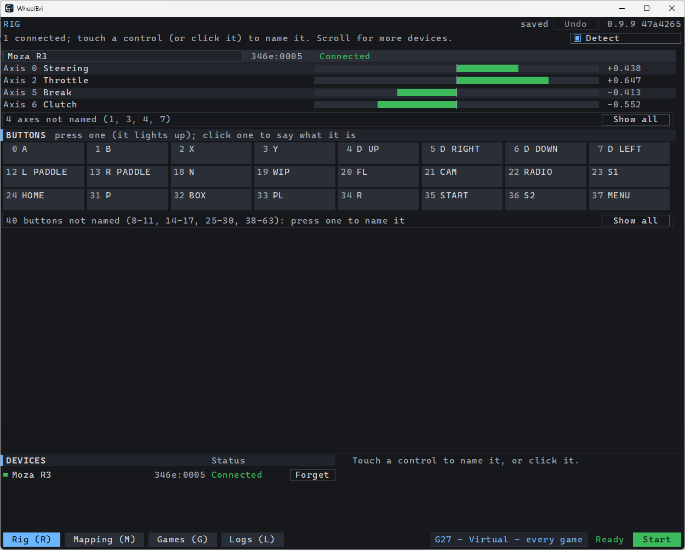

1. With **Detect** on, touch a control: turn the wheel, press a pedal **all the way**, press a button. Its popup opens.
2. Give it a **Name** and pick what it **is** (Steering, Throttle, Brake, Clutch, a button...), then **OK**.
3. Repeat for every control you use, and name each device.

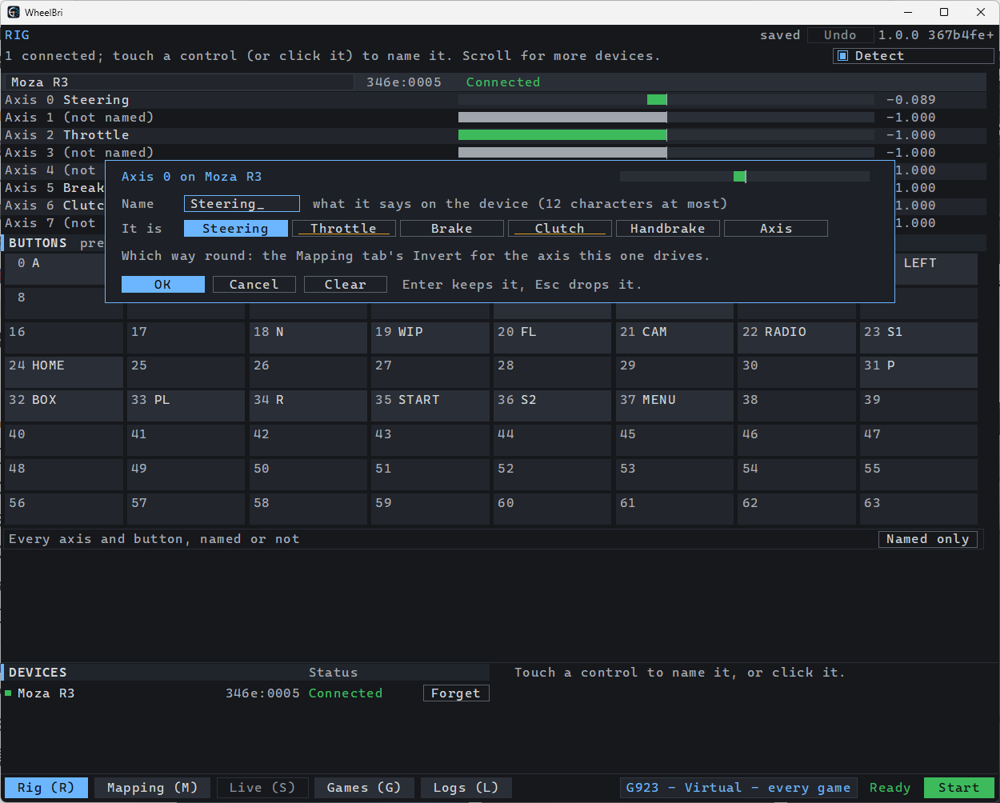

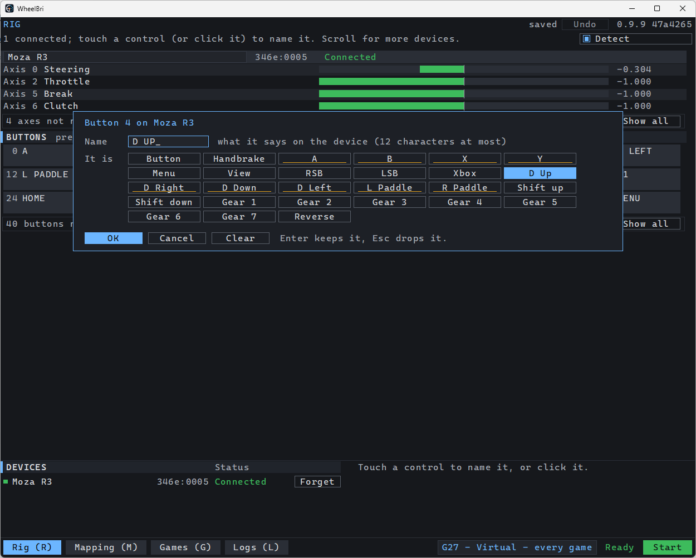

What a control **is** maps it by itself on every Target: Steering, the pedals, the D-pad, **A**, **B**, **X**, **Y**
and the paddles (on the G25 and G27, A B X Y go on the shifter's black buttons). Each belongs to one control: a choice
underlined in amber is another control's already (point at it to see whose), and picking it moves it here. Every other
button you map yourself.

Once a device has named controls, the unnamed ones fold into one line; **Show all** / **Named only** switch.

The device with Steering is the wheel and plays the force feedback. WheelBri has no dead zones: set those, and the
wheel's rotation, in the wheel's own software (Pit House for Moza).

## Map it to the Target

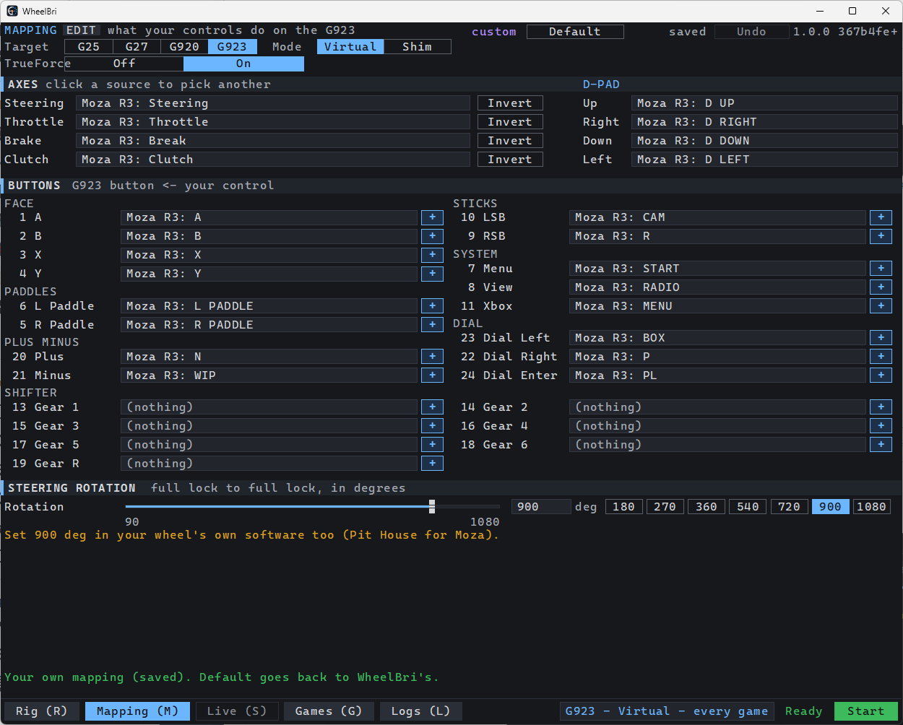

1. Pick the **Target** and **Mode** at the top (locked while running).
2. Check each axis, D-pad direction and button comes from the right control. Click a source to change it: move the
   control on your rig, or type to find it. **RIG** next to a source means it comes from the Rig tab. Greyed sources
   are used elsewhere (point at one to see where); clicking one moves it here.

   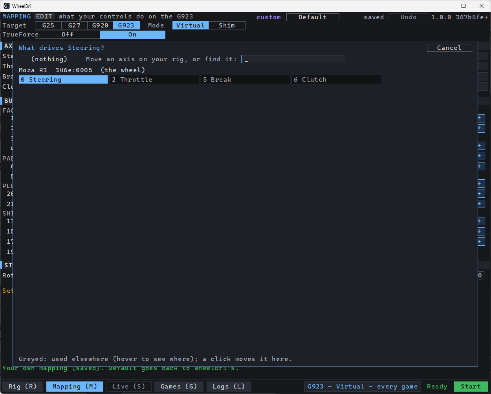

   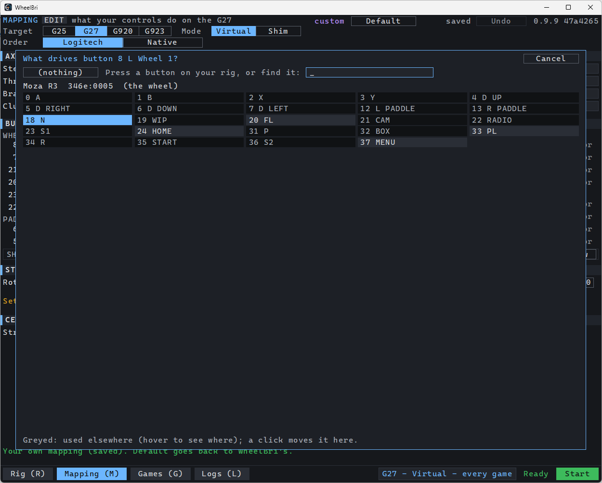

3. Tick **Invert** for a pedal that reads pressed at rest (never automatic).
4. The blue **+** at the end of a button's row adds more controls that activate it (up to 8), e.g. a handbrake lever:
   it activates the button past the point you set, from 0% (as soon as it moves) to 100% (only at its end). They show
   as **or ...** in the row; click one to change them.
5. Set **Steering rotation** to the game's full lock, and your wheel's software to **the same number**.

**G25 and G27 only:**

- **Centring spring**: that wheel's own spring to the centre on top of the game's forces, 0 to 100% (off by default).
  For games that send no centring of their own, such as Race Driver: GRID.
- **Order**: how the game numbers the buttons. **Logitech** (default) for games of that era; **Native** for
  newer games' presets, such as ACC's. Each order has its own mapping. The first Native mapping starts as a copy of
  the other with its buttons in amber: their numbers changed, so check them against the game; **Got it** clears the
  marks.

The Target's buttons show **the numbers the game uses**: from 1 in Logitech order (as `joy.cpl` and games
count), from 0 in Native. To see which one the game gets, use the [Shadow view](#shadow-view) while running. Details:
[targets.md](targets.md).

**Default** goes back to WheelBri's mapping.

## Play

Press **Start** before the game, and **Stop** when done. Start the game only once the status says **Running**: by
then everything is ready. On Linux the game's Steam launch option does this for you
([Linux and the Steam Deck](#linux-and-the-steam-deck)).

The bar next to Start shows the Target, the Mode and, in Mode Shim, the game, in amber when the game does not support
the Target. When Start is greyed out, the red notice above the tabs says why; **What's missing** lists what is left.

**Mode Virtual**

1. Close the wheel maker's software if it holds the wheel.
2. Press **Start**. On Windows the wheel reconnects once to hide it from games (don't unplug anything). If it cannot
   be hidden, Start fails and the Logs tab says what holds it.
3. Start the game and pick the Logitech wheel in its controller settings.
4. **Stop** reconnects the wheel unhidden.

**Mode Shim**

1. On the Games tab, add your games: pick one and press **Choose folder...** (or **Add game...** for one WheelBri does
   not know), and choose the folder with its `.exe`.
2. Press **Start**. Each listed game gets the right shim (32 or 64-bit, next to the Ultimate ASI Loader if present).
   Another mod's `dinput8.dll` (a Widescreen Fix, ReShade) is chained, never overwritten: it is renamed to
   `dinput8-chain.dll`, the shim goes in its place and hands DirectInput on to it, so the mod keeps working. **Remove
   shim** gives it its name back. Only a mod built for the other processor than the game is left alone (that game is
   left out).
3. Start the game and pick the Logitech wheel. If it runs 2 minutes without a word from the shim, WheelBri warns you:
   check its folder on the Games tab and restart the game.
4. At **Stop**, choose whether to delete the shims from the games' folders.

**Hot swap** (Games tab, on by default): changing the Target in Mode Shim updates every game folder with the shim;
restart a running game to get it. With a wheel that is not a Moza, set `source_vid` in the game folder's
`wheelbri-shim.ini` to your wheel's vendor id (the first 4 characters of its `vid:pid` in the Rig tab). Do not use
both Modes for one game.

## Shadow view

While WheelBri runs, the Mapping tab shows the Target as the game sees it: the real wheel drawn from Logitech's own
pictures, with its pedals and shifter, every control lit while the game gets it pressed. It shows what the game
receives after your mapping, so it is the place to check a mapping in action.

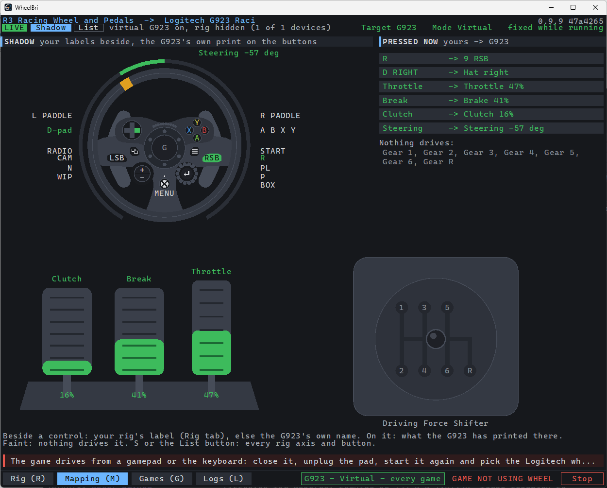

- **Buttons** light while pressed. On each is its number as the game counts it (from 1 in Logitech order, from
  0 in Native); on the G920 and G923, what is printed on the real button instead (A B X Y, LSB / RSB, View, Menu,
  Xbox, the G923's + and -), and nothing on their paddles.
- **Beside each button**: the label you gave its control in the Rig tab, or the wheel's own name (Red 2, a gear) when
  the control has none.
- **Faint** controls have nothing mapped to them: the quick way to spot what is left to map.
- **Steering**: an arc round the rim grows as you turn, reaching its end at full lock; a mark shows where the rim's top
  is.
- **Pedals** fill as you press them; the **D-pad** lights its arms.
- **Shifter**: the knob sits in the gear the game sees engaged (G25 and G27 with their button panel; G920 and G923
  with the Driving Force Shifter's gate).
- **G923 dial**: its left or right teeth light as it turns.
- **Pressed now**, on the right: every control pressed at this moment, as "your control -> the Target's".

**Shadow** / **List** in the Mapping tab's header (or **S**) switch views. **List** shows every axis of your rig as
it reads them, next to what the Target reports, and only the mapped buttons (the Target's and the rig's), with **Last
pressed** naming the Target's button you pressed last and what drives it ("G920 7 Menu <- Rig 35 Start"). Use it when a
control does nothing in the Shadow view: Last pressed also names an unmapped button, so List shows whether the rig sees
it at all.

## Games tab

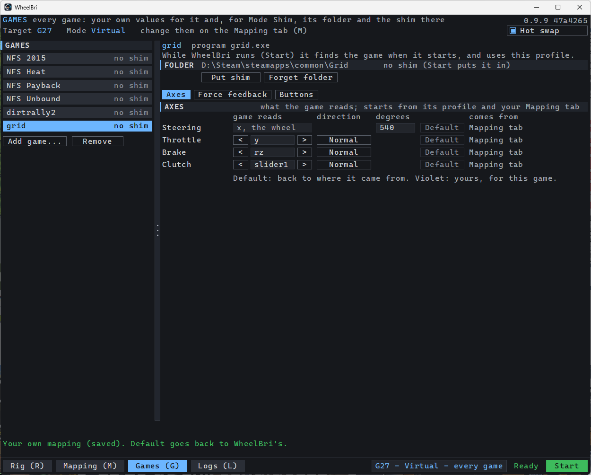

Values for one game at a time, kept per Target. A few games have a built-in profile applied while they run (NFS 2015,
NFS Payback, NFS Unbound); built-in profiles work with **Target G920 only**, your own values with every Target.

1. Pick the game on the left. Tags show what is in its folder (`shim g920`, `+ASI` next to the ASI Loader, `+mod`
   chained to another mod, `no shim`, `other mod`: **Chain mod** chains it now), `! not G923`
   when the game does not support the Target, `running` for the one WheelBri sees now. **Add game...** picks a game's
   `.exe`; **Remove** takes one you added off the list (its files stay).
2. Set its sub-tabs; **Default** goes back to the profile's or the Mapping tab's value (yours show in violet):
   - **Axes**: steering rotation; per pedal, the axis the game reads and Normal / Inverted. In Mode Virtual pedals can
     only be swapped among the Target's own pedal axes.
   - **Force feedback**: overall strength, a gain per effect (0 off, up to 4), a lower cap or slew limit, the
     frozen-push fade, reversed forces, or none at all.

     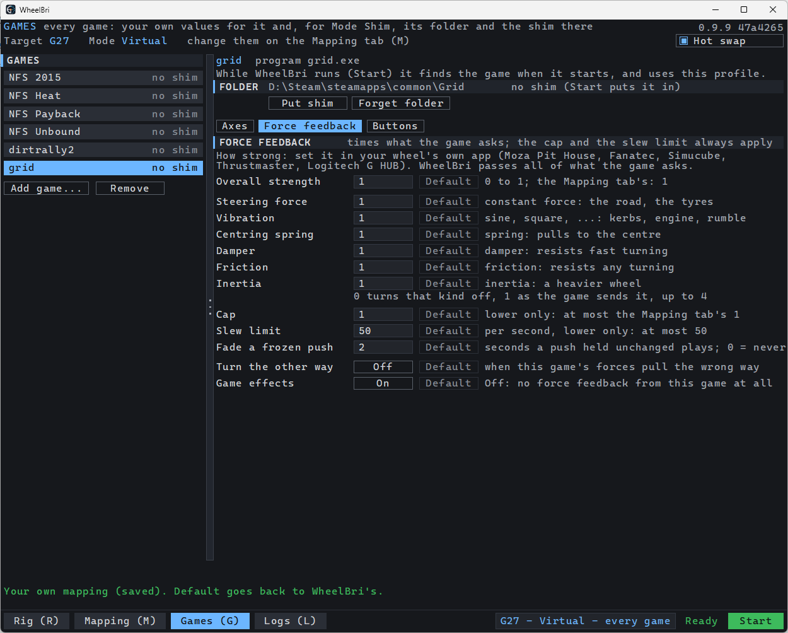

   - **Buttons**: only the buttons you change for this game; **Remove** gives one back to the Mapping tab.

     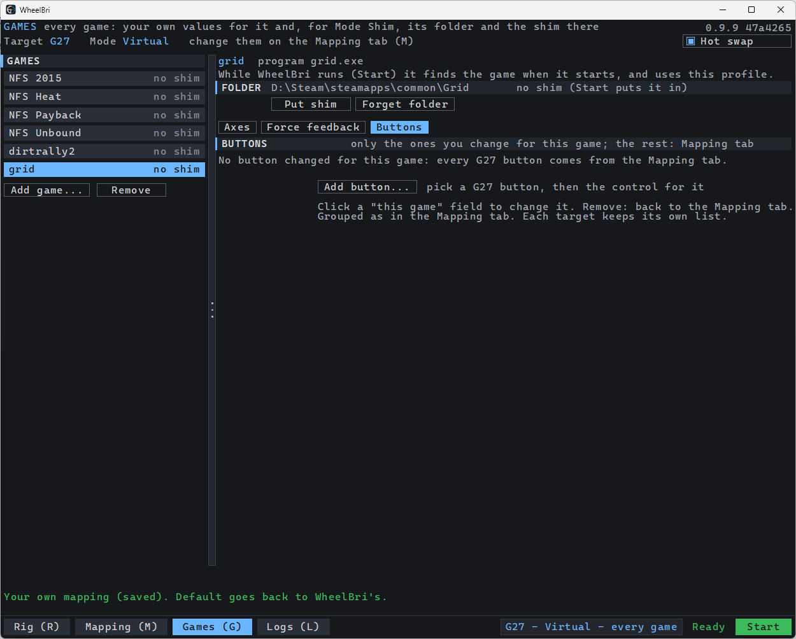

     **Add button...** asks which Target button to change and adds its row, starting from the Mapping tab's values.
     Click its **this game** field to pick its control, or its **secondaries** field to add controls that activate it
     too (buttons, or a lever past a point, up to 8). Any control works, even one the Mapping tab uses elsewhere. A
     game's secondaries replace the Mapping tab's for that button; **Mapping tab's** in either popup follows the
     Mapping tab again.

     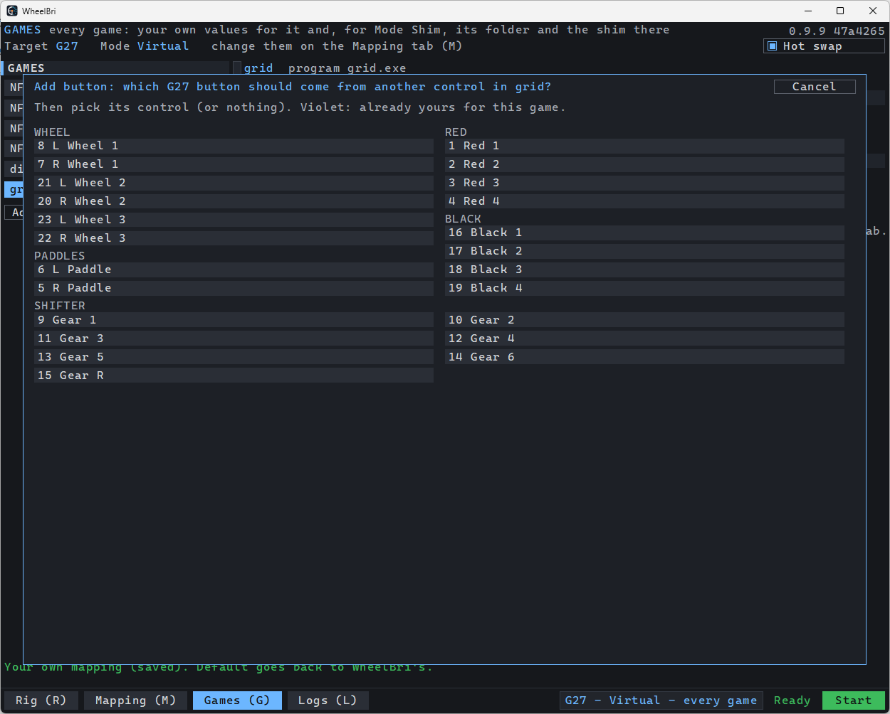

     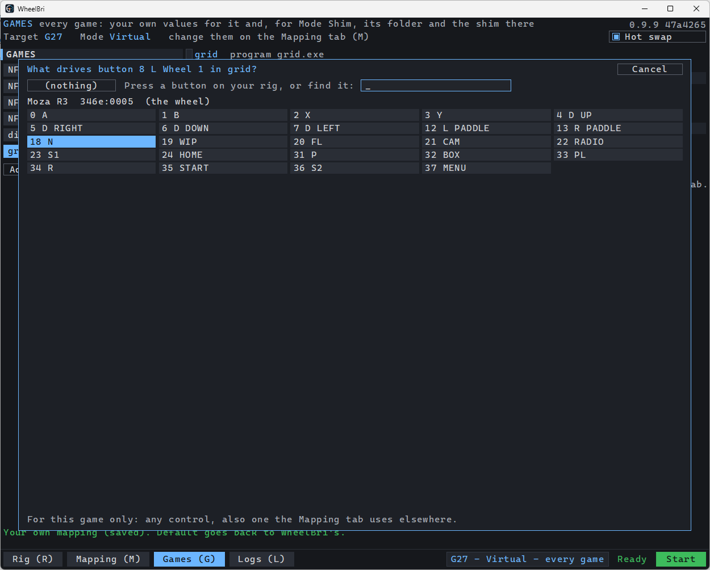

     The row shows the Mapping tab's values and this game's; what is this game's own is in violet.

     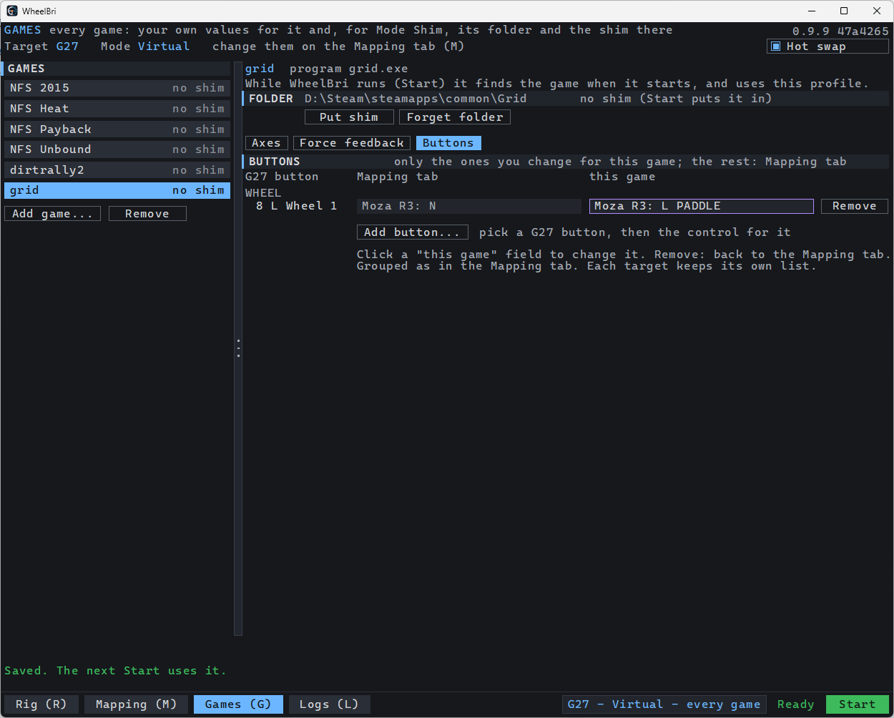

   - **Game file** (NFS Unbound): writes the game's hidden wheel settings with **Save to file** (game closed).

Values apply at once, even while the game runs (the Force feedback sub-tab then shows what the game asks in blue and
what reaches the wheel in green). Pedal axes in Mode Shim and new games apply at the next Start.

## Linux and the Steam Deck

Set up the rig and the mapping in the app first (`~/wheelbri/bin/wheelbri`), as above, and save the mapping: Linux
numbers the axes differently from Windows, so WheelBri's default mapping (made on Windows) needs checking. Then let
Steam start WheelBri with the game: in the game's **Properties > Launch Options**, put

```
/home/deck/wheelbri/wheelbri.sh %command%
```

(with your own home folder if it is not `/home/deck`). `wheelbri.sh` starts WheelBri before the game and stops it when
the game ends, in Game Mode too. If the app (Start) or `wheelbri-service` is already running, it uses that session
and leaves it running.

Options go between `wheelbri.sh` and `%command%`, e.g.
`/home/deck/wheelbri/wheelbri.sh --target g25 --shim %command%`:

| Option | Default | What it does |
|---|---|---|
| `--virtual` | yes | Mode Virtual: `wheelbri-uhid` creates the virtual wheel; the game reads it raw (Proton's `PROTON_ENABLE_HIDRAW`) and your rig is hidden from it. A WheelBri shim left in the game's folder is taken out first. |
| `--shim` | | Mode Shim: puts `dinput8.dll` (32 or 64-bit, as the game's `.exe`; `dinput8Hooked.dll` next to the Ultimate ASI Loader) and `wheelbri-shim.ini` into the game's folder before it starts and takes them out after. Another mod's `dinput8.dll` is chained (as Start in the app does) and given back after; one built for the other processor is refused. |
| `--target g25\|g27\|g920\|g923` | the app's Mapping tab Target, else G920 | The Logitech wheel the game sees. |
| `--config FILE` | your saved mapping for the Target (`~/.config/wheelbri/configs/my-<target>.ini`), else WheelBri's default | The mapping to use. |
| `--hide VID/PID[,VID/PID...]` | every device of your rig (Rig tab) | Devices hidden from the game in Mode Virtual, e.g. `--hide 0x346E/0x0005` for a Moza R3. Steam's own pad is never hidden. |
| `--game-folder DIR` | the folder of the game's `.exe` in `%command%`, else its Steam install folder | Where `--shim` puts the shim. Needed when the game starts through a launcher that hides the real folder. |
| `--keep-shim` | | Leaves the shim in the game's folder after the game ends (for testing). |
| `--ui` / `--no-ui` | window only when run from a terminal | Shows the WheelBri window while the game runs, or not. |
| `--help` | | Prints these options. |

From a terminal (Desktop Mode) without `%command%`, `wheelbri.sh` starts WheelBri and waits for Enter or Ctrl+C to
stop it. Logs: `~/.local/state/wheelbri/`.

## Force feedback

**Set the strength in your wheel's own app**, once for every game: Moza Pit House, Fanatec's tuning menu, Simucube
True Drive, Thrustmaster's control panel, Logitech G HUB. WheelBri passes on all the game asks, through safety limits:
no sudden jumps, a push left unchanged for 2 s (a loading screen) fades out, forces stop when the game goes quiet, and
a value that is not a force plays nothing.

For one game use the Games tab. For every game, edit `[ffb]` in your mapping file and press Start again:
`%LOCALAPPDATA%\wheelbri\configs\my-<target>.ini` (Windows), `~/.config/wheelbri/configs/my-<target>.ini` (Linux).

| Setting | Default | |
|---|---|---|
| `master_gain` | 1.0 | overall strength; better set in the wheel's app |
| `max_magnitude` | 1.0 | hard cap, on all forces together (1 = none) |
| `invert` | false | `true` if forces pull the wrong way |
| `game_effects` | true | `false` turns game force feedback off |
| `centring_spring` | 0 | G25 and G27: their centring spring, 0 to 100% |
| `ignore_lone_full_push` | true | a full push with no other forces for 2 s plays as none (Race Driver: GRID) |

**TrueForce** (Target G923, Windows): `[emulator] trueforce = true` in the same file lets games that use Logitech's
TrueForce (ACC) drive your wheel with it. Off by default. What it needs: [Games](games.md#assetto-corsa-competizione).

To test the wheel, press Stop and run (Windows, Command Prompt):

```
"C:\Program Files\WheelBri\wheelbri-service.exe" --ffb-test --config "%LOCALAPPDATA%\wheelbri\configs\my-g920.ini"
```

Linux:

```bash
~/wheelbri/bin/wheelbri-service --ffb-test
```

## Logs

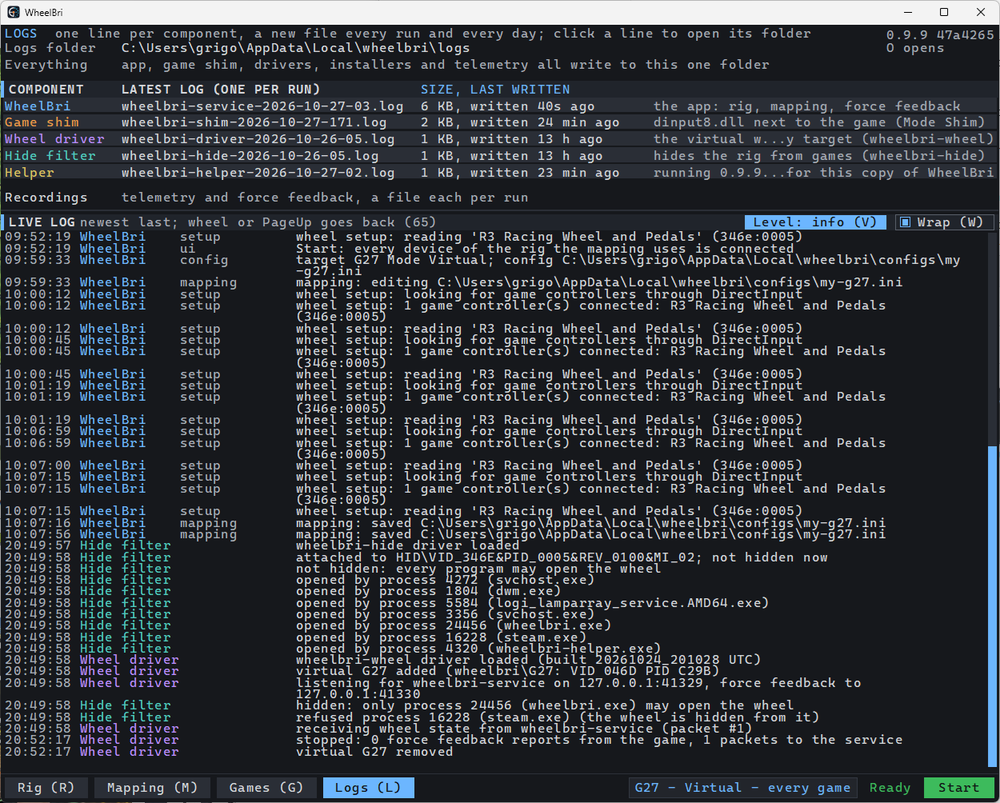

The **Logs** tab shows what every part of WheelBri does; **O** opens the folder (`%LOCALAPPDATA%\wheelbri\logs` or
`~/.local/state/wheelbri`). Logs older than 2 days are deleted.

To report a problem: set **Level** to debug, repeat it, press Stop, and send that run's files with the Target, Mode,
game and what you saw. Set Level back to warn afterwards.

## Troubleshooting

Check the Logs tab first: a failed Start says why, in red.

| Status | What to do |
|---|---|
| `NO RIG` / `NO WHEEL IN THE RIG` | Name your controls in the Rig tab. |
| `NO MAPPING` | Map the Target in the Mapping tab. |
| `NOT CONNECTED: <names>` | Switch on or plug in those devices. |
| `WHEEL LOST` | A device was unplugged or switched off: plug it back in. |
| `GAME NOT USING WHEEL` | The game drives from a gamepad or keyboard: see below. |
| `GAME FFB OFF: ALT-TAB` | Alt+Tab out of the game and back. |
| `NFS 2015: RESET ITS WHEEL CONTROLS` | Reset the game's wheel controls to default. |
| `HELPER NOT INSTALLED` (Windows) | Win+R, `services.msc`, start "WheelBri Helper", or run the setup again. |

**The game sees no wheel.** Press Start *before* the game and wait for `Running`. Mode Shim: the game's FOLDER on the
Games tab must say "shim in place"; with a non-Moza wheel check `source_vid`. Also see the game in
[games.md](games.md).

**The game sees two wheels.** Mode Virtual: close the wheel maker's software and the game, replug the device, Start
again. Mode Shim hides nothing: pick the Logitech wheel.

**The game drives from a gamepad or keyboard.** Close the game, unplug the gamepad, start the game again and pick the
Logitech wheel.

**No force feedback, but the wheel works.** Alt+Tab if the status says so; check force feedback is on in the game and
the wheel's software and `game_effects = true`; try `--ffb-test`.

**The pedals are wrong.** Check their sources on the Mapping tab and press each: one pressed at rest needs **Invert**.
One that does not reach 100%: set its range in the pedals' own software.

### Windows

**The rig stays hidden after a crash.** Press Start and Stop once. Still hidden with WheelBri closed: run from an
Administrator Command Prompt:

```
"C:\Program Files\WheelBri\wheelbri-service.exe" --unhide
```

**The app does not start on Windows 7.** The Universal C Runtime (KB2999226) is missing: run
`install-prerequisites.cmd` from the package's `win7` folder and restart.

### Linux

**`wheelbri-uhid` stops with `Permission denied` on `/dev/uhid`.** Run `install-udev-rules.sh`, log out and in. With
`No such file`: `sudo modprobe uhid`.

**The game sees no wheel.** Put `PROTON_LOG=1 WINEDEBUG=+hid,+dinput` before the launch option and look for the
Target's id (G920: `046d:c262`) in `~/steam-<appid>.log`.

**Two wheels in the game.** Save the rig in the Rig tab (only its devices are hidden), or pass `--hide 0x346E/0x0005`.

**`--shim` refuses ("another mod's, built for the other processor").** That mod's `dinput8.dll` cannot run in the
game anyway: remove it, or use Mode Virtual.
